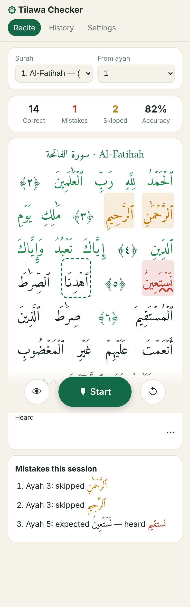

# Tilawa Checker — free Quran recitation checker

A free web app: choose a surah, press **Start**, and recite. Each word turns
**green** when correct, **red** when wrong, and **orange** when skipped. Mistakes
are counted through the session and saved to your history.

## Features
- Mushaf-style view: the 604 pages of the Madani mushaf, shown as a two-page spread on wide screens and one page on phones; pages turn automatically as you recite
- All 114 surahs (Uthmani script) with optional English translation; recitation continues from one surah into the next
- Start from any ayah, or tap any word to start from there
- Live mistake detection with beep and vibration, plus a mistake list for each session
- Memorization mode (hides the text and reveals it as you recite)
- History: past sessions, accuracy, and the words you miss most often
- Going back to repeat earlier ayat is not counted as a mistake
- Handles isti'adha/basmala before reciting, repeated words, and disconnected letters (الم، يس…)
- Installable on your phone's home screen; the Quran text works offline

## Speech engines
- **Browser engine** (Chrome, Edge, Safari): Google's speech service; fast, word-by-word, needs internet.
- **On-device Quran AI** (used automatically in Brave, Firefox and others): the Quran-trained Whisper model
  [tarteel-ai/whisper-base-ar-quran](https://huggingface.co/tarteel-ai/whisper-base-ar-quran) (Apache-2.0), ONNX build
  [aaqibhabib/whisper-base-ar-quran-onnx](https://huggingface.co/aaqibhabib/whisper-base-ar-quran-onnx), run in the browser with
  [Transformers.js](https://github.com/huggingface/transformers.js). Downloads about 105 MB once, then is cached; audio never leaves
  the device. It checks each phrase after you pause, so it is slower than the browser engine.
- Switch in Settings → Speech engine.
- **Harakat check (beta)** (Settings): while Google checks the words, the on-device Quran model also listens and writes what it
  hears with harakat; words whose fatha/damma/kasra/tanween differ are flagged in purple as *possible* harakat mistakes
  (not counted in the score, because the model can mishear). The last word before a pause is excused (waqf).

## Limits
- Word checking is reliable; the harakat check is a beta. Tajweed rules (madd, ghunnah, makharij) are not checked, and can sometimes mishear a word.
  If you get false alarms, set *Strictness* to *Lenient* in Settings.

## Run it
It is a static site; there is no build step. Host it with GitHub Pages
(Settings → Pages → choose this branch and `/ (root)`), or run it locally with
`python3 -m http.server` and open http://localhost:8000.

## Credits
Page layout: [quran-meta](https://github.com/quran-center/quran-meta) (MIT, see `data/LICENSE-quran-meta.txt`).
Quran text: The Noble Qur'an Encyclopedia (quranenc.com); translation: Saheeh International,
via the open [quran-json](https://github.com/risan/quran-json) dataset (CC BY-SA 4.0, see `data/LICENSE-quran-json.txt`).
